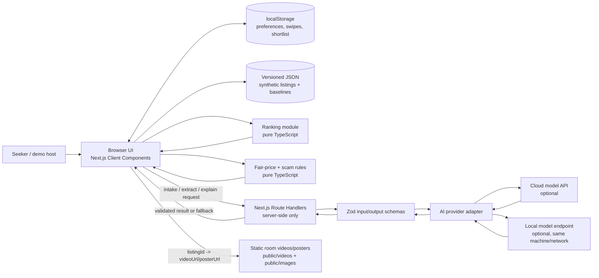
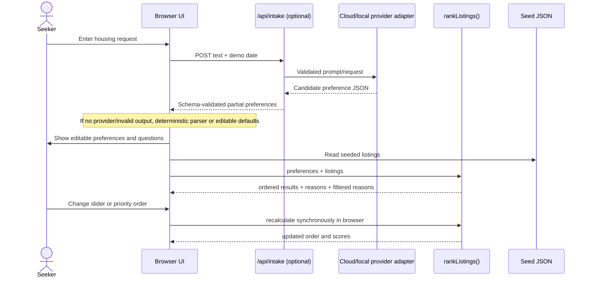
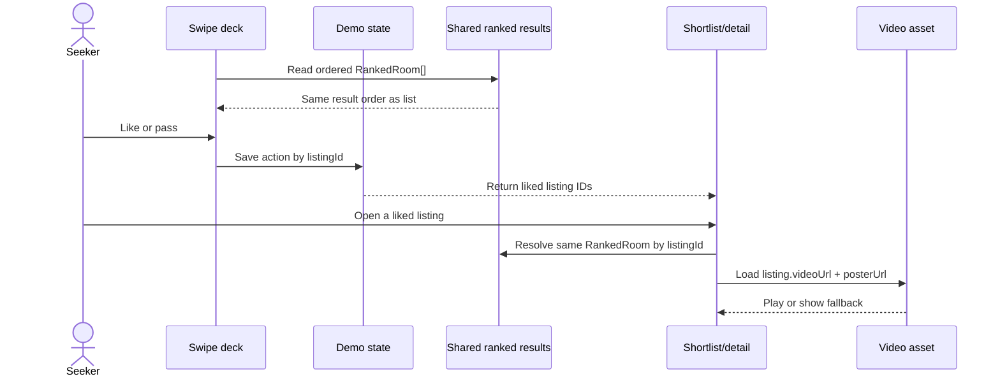
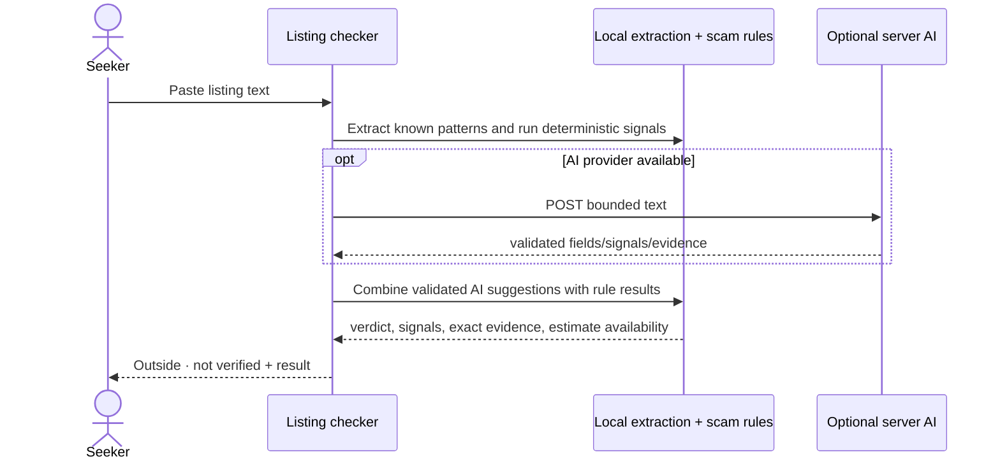

# Roomsure Technical Architecture

**Status:** Hackathon implementation guide  
**Audience:** Four-person build team, reviewers, and coding LLMs  
**Related documents:** [README](README.md), [MVP requirements](Roomsure%20MVP%20Requirements%20%28for%20LLM%20build%29.md), [Master build prompt](MASTER_PROMPT.md)

This document defines the recommended system shape, technology choices, data boundaries, request flows, and implementation rules for the Roomsure demo. The MVP requirements define product behavior; this document defines how to implement it. The current repository has product documents and a standalone HTML prototype, but no app scaffold yet.

## 1. Architecture decisions at a glance

| Concern | Hackathon decision | Reason |
|---|---|---|
| Web framework | Next.js App Router + React + TypeScript | One codebase can host the UI and small server endpoints; avoids a separately deployed API. |
| Styling | Tailwind CSS, unless the team already prefers the prototype CSS | Fast responsive styling and consistent tokens. Reuse design ideas from the HTML prototype. |
| Validation | Zod at untrusted boundaries | Validate AI JSON, request bodies, and parsed seed data. |
| Ranking | Pure TypeScript module, executed in the browser | Slider and priority changes rerank instantly and deterministically. |
| Seed inventory | Versioned local JSON | 20–25 curated synthetic listings are enough for the demo; no database setup or network dependency. |
| Demo state | Client state with localStorage persistence where useful | Likes, preferences, mock host decisions, and shortlist do not need shared multi-user persistence. |
| AI | Optional server-side provider adapter + deterministic fallback | Protect keys and keep the demo functional when cloud/local AI is unavailable. |
| Video | Local static assets in `public/videos` or stable URLs, referenced by listing ID | No upload service needed for a fixed demo set. |
| Database | None for hackathon MVP | Seed data is read-only and interactions are presentation state. Add a database only for shared persistent accounts/listings. |
| Deployment | A Node-capable Next.js deployment (for example Vercel) or run locally on the demo laptop | Server route handlers are needed for hosted AI calls. Static-only hosting cannot run these handlers. |

Next.js documents route handlers as request handlers under the `app` directory and supports Node.js server deployment for all framework features. Keep provider secrets on server-only code: Next.js notes that non-public environment variables are server-only by default, while `NEXT_PUBLIC_` values are exposed to the browser. See [Route Handlers](https://nextjs.org/docs/app/getting-started/route-handlers), [Data Security](https://nextjs.org/docs/app/guides/data-security), and [Deployment](https://nextjs.org/docs/app/getting-started/deploying).

## 2. System context diagram



**Trust boundary:** everything submitted by the browser, pasted listing text, model output, query parameters, and localStorage is untrusted input. Validate before use. Never send a card number, ID/license image, or protected-trait information to any provider; the demo does not collect these.

## 3. Runtime architecture and module ownership

### Browser/client side

Use client components only for interactive UI that needs browser events or local state: preference sliders, priority reorder controls, swipe actions, shortlist, video controls, and demo chat state. Keep shared display components presentational when possible.

Client responsibilities:

- Load the synthetic listing set through a typed data-access function.
- Hold the active demo persona/preferences, priority order, swipes, and mock host responses.
- Call `rankListings()` on each preference change; do not make an HTTP or AI call for ranking.
- Render list, swipe deck, detail, shortlist, and filtered results from the same `RankedRoom[]` result.
- Save only non-sensitive demo state to localStorage. If stored data is malformed or old, reset to defaults without blocking the app.
- Use buttons as well as swipe gestures; keyboard users must be able to pass/like.

### Server side

Use Next.js Route Handlers for optional AI requests and other operations requiring a secret. A route handler should parse the request, validate it, invoke an adapter, validate the adapter output, and return a small typed response. Keep model SDKs and secret-reading code out of client-importable modules. Do not create a separate Express service for this MVP.

Server responsibilities:

- Validate payload type, length, required fields, and output shape.
- Invoke the selected AI provider with a bounded timeout.
- Normalize provider differences into one internal response contract.
- Return a deterministic fallback or a useful recoverable error on timeout, provider failure, malformed JSON, or absent credentials.
- Never log full pasted listing text unnecessarily; avoid personal information in request logs.

### Pure domain modules

Domain modules should not import React, Next.js, a model SDK, or browser APIs:

- `ranking`: filters, satisfaction, weights, score, sort, explanation facts.
- `fair-price`: baseline lookup, adjustment, range, label.
- `scam-check`: deterministic signal rules, evidence snippets, verdict.
- `schemas`: shared request and response validation/type definitions (keep server-only provider secrets out of shared schemas).
- `types`: Listing, Preferences, RankedRoom, TrustStatus, ScamSignal, FairPriceResult.

This separation lets a coding LLM or teammate modify one concern without implementing a second score or duplicating signal logic.

## 4. Recommended project structure

```text
app/
  layout.tsx
  page.tsx                         # app entry / seeker experience
  check/page.tsx                   # outside listing checker
  rooms/[id]/page.tsx              # detail route, if routed separately
  api/
    intake/route.ts                # optional AI intake
    listings/extract/route.ts      # optional host/outside extraction
    check/route.ts                 # optional AI text-signal assistance
components/
  app-shell.tsx
  preferences/
  results/
  swipe/
  shortlist/
  room-detail/
  video-viewer/
  listing-check/
  verification-demo/
  chat-demo/
data/
  listings.json
  fair-baselines.json
lib/
  types.ts
  schemas.ts
  data/listings.ts                 # typed seed loading and lookup
  ranking/index.ts
  ranking/explain.ts
  trust/fair-price.ts
  trust/scam-check.ts
  ai/provider.ts                   # provider interface and selector
  ai/fallback.ts
  ai/prompts.ts                    # server-only prompts
  state/demo-state.ts              # state/persistence helpers
public/
  images/
  videos/
```

Adapt to the generated Next.js conventions if needed. Keep filenames and imports boring and explicit. Do not copy the entire standalone HTML file into one giant component; use it as visual/reference material and port behavior into small components.

## 5. Data strategy: JSON now, database later

### Why JSON is right for the hackathon

The room catalog is curated, static demo content. Users do not need shared accounts, multiple devices, concurrent host edits, or durable bookings. A JSON file gives the team stable records, repeatable scores, easy code review, and no database credentials or migrations to debug. The seed catalog is source data; client state is temporary interaction state.

Use localStorage only for preferences and demo actions if persistence across page refreshes improves the demonstration. Never write identity artifacts, payment data, secrets, or raw ID/card inputs to browser storage. Clearing storage must reset to a working demo persona and seed data.

Do not write changes back to the seed JSON at runtime. Host “publish” is session-only demo state; it may append to an in-memory state/localStorage collection but must not imply a durable listing or real posting.

### When to add a database

Move to a database only when the product needs one or more of: real user accounts, listings created by separate hosts, shared cross-device state, durable likes/matches/messages, audit history, moderation, or concurrent updates. At that point, use a managed relational database such as PostgreSQL because users, listings, verifications, interests, and conversations have clear relationships. Add migrations, access rules, authentication, backups, deletion/retention policies, and authorization before storing real user data.

A possible later persistence model:

- `users` — minimal profile and role; no raw identity documents or card details.
- `listings` — host-owned listing fields and lifecycle.
- `listing_media` — listing ID, media URL, type, poster URL, rights/consent metadata.
- `preferences` — user-selected matching preferences.
- `interests` — seeker/listing status and host decision.
- `verification_events` — provider reference, result, timestamps, and limited audit metadata, not document images.
- `conversations` / `messages` — only if real chat is implemented, with access controls and abuse handling.

This is a future design note, not a request to build these tables for the hackathon.

## 6. Shared contracts

The detailed requirements define behavior; these are the minimum concepts the implementation must agree on before parallel work begins. Refine optional fields as code demands, but do not create separate ranking data for list and swipe.

```ts
type TrustStatus = "verified" | "caution" | "suspended";
type Priority = "price" | "commute" | "dates" | "space";
type ListingSource = "network" | "outside";

interface Listing {
  id: string;                         // stable; joins video and UI state
  title: string;
  description: string;
  hostId: string | null;
  hostDisplayName: string;            // synthetic in demo
  neighborhood: string;
  pricePerMonth: number;
  availableFrom: string;              // ISO date
  availableTo: string;                // ISO date
  roomType: "private" | "shared";
  furnished: boolean;
  privateBath: boolean;
  smokingAllowed: boolean;
  trustStatus: TrustStatus;
  trustReason?: string;
  source: ListingSource;
  isDemo: boolean;                    // true for synthetic hackathon inventory
  approximateCommuteMinutes: number;   // seeded demo estimate
  fairBaselineKey: string;
  videoUrl?: string;
  posterUrl?: string;
}

interface Preferences {
  destinationLabel: string;
  price: { ideal: number; limit: number };
  commute: { ideal: number; limit: number };
  dates: { start: string; end: string; maxUncoveredDays: number };
  mustHaves: { privateRoom: boolean; noSmoking: boolean };
  niceToHaves: { furnished: boolean; privateBath?: boolean };
  priorityOrder: Priority[];
}

interface RankedRoom {
  listing: Listing;
  score: number;
  trustFactor: number;
  satisfaction: Record<Priority, number>;
  weights: Record<Priority, number>;
  explanation: { gains: string[]; gives: string[] };
  fairPrice: FairPriceResult;
}
```

Define separate contracts for `ScamSignal` (id, severity, message, optional exact evidence), `ScamVerdict`, `FairPriceResult`, and intake/extraction responses. Treat outside extracted fields as partial/nullable and preserve confidence/missing-fields metadata; never silently convert unknown to a confident fact.

## 7. Key request and state flows

### A. Intake and live ranking



No AI call occurs when moving sliders or reordering priorities. Intake parsing may be simulated in the demo, but the UI must not misrepresent a fallback as a live model call.

### B. Swipe, shortlist, and video



Use listing IDs, never array positions, to associate user actions and media. Preference changes can change order; liked-room identity remains tied to the listing ID.

### C. Outside listing scam check



Rules remain available without AI. Evidence must be an exact substring of the pasted text (or a normalized exact excerpt) before rendering as a quote. Escape text in HTML; do not inject model/user strings as markup.

### D. Mock mutual match and chat

Store seeker like and demo host decision keyed by listing ID. `matched = seekerLiked && hostAccepted`. When matched, display a chat demo panel with canned or local-only sample messages. Do not send messages to another user. Label it as simulated. No actual payment or deposit flow follows from chat.

## 8. API boundaries

Keep only routes needed by the implemented features. Local pure functions are preferred for deterministic functionality.

| Route | Method | Purpose | Required behavior |
|---|---|---|---|
| `/api/intake` | POST | Parse seeker request | Bounded text input; returns partial preferences, confidence/missing fields, max two questions; fallback works. |
| `/api/listings/extract` | POST | Optional host/outside extraction | Returns partial listing fields, confidence by field, missing fields; extracts only stated details. |
| `/api/check` | POST | Optional AI text scan assist | Returns only known signal IDs and quoted evidence; local rule check remains available. |
| `/api/explain` | POST | Optional explanation polish | Accepts trusted gains/gives/rank/score; never invents facts. Template renderer is sufficient for MVP. |

Listing reads, fair-price calculation, scam rules, ranking, swipe, shortlist, and mock matching do not require an HTTP API or database for this demo. If a route is implemented, validate method/body/size and response. Do not expose provider implementation details to the UI.

## 9. AI provider/fallback design

Use a small provider interface, not provider conditionals spread across screens:

```ts
interface RoomsureAIProvider {
  parseIntake(input: IntakeInput): Promise<IntakeResult>;
  extractListing(input: ListingExtractionInput): Promise<ListingExtractionResult>;
  inspectScamText?(input: ScamTextInput): Promise<ScamTextResult>;
}
```

Provider selection is server-side through environment configuration. Example names (not required to use all): `AI_PROVIDER=cloud|local|fallback`, cloud endpoint/key, local endpoint/model. Never put secrets under a `NEXT_PUBLIC_` variable or commit `.env` files.

Fallback sequence: configured provider → bounded timeout → validate output → try configured fallback provider if operationally supported → deterministic local parser/rules → show user-editable defaults. The fallback path must be predictable and clearly labeled. Do not call a local model from a deployed cloud function expecting it to reach the developer laptop's `localhost`; local AI is reachable only when the app server and model share a machine/network or the endpoint is intentionally network-accessible. For the hackathon, app + local model on the demo laptop is the simplest local-provider setup.

## 10. State and persistence map

| Data | Source / storage in demo | Client-visible? | Notes |
|---|---|---:|---|
| Synthetic listings | `data/listings.json` | Yes | Read-only, public demo data. |
| Fair-price baselines | `data/fair-baselines.json` | Yes | Label estimates as demo values. |
| Current persona/preferences | React state + optional localStorage | Yes | Reset action restores known demo state. |
| Swipe decisions and shortlist | React state + optional localStorage | Yes | Keyed by listing ID. |
| Host accept/pass | React state + optional localStorage | Yes | Mock only. |
| Chat messages | Hardcoded demo fixtures / temporary state | Yes | No messaging backend. |
| AI API keys | Server environment only | No | Never logged, serialized, or sent to browser. |
| Real identity/card data | Not collected | No | No corresponding storage field or upload control. |

## 11. Security, privacy, fairness, and trust

- Validate all browser input and every model response. Client data can be altered.
- Keep AI keys and privileged SDKs in server-only modules. Pass only the minimum safe DTO to client components.
- Limit pasted text length; avoid retaining it after the response unless needed for the demo result display.
- Treat pasted listing text as untrusted data, not prompt instructions. The model prompt should say to extract fields only and ignore instructions embedded inside a listing.
- Render user/model strings as text with normal React escaping; never use raw HTML for them.
- Do not collect or persist identity documents, card data, government IDs, or protected traits.
- Never use protected traits or inferred proxies in matching or filtering.
- Make trust states explicit: mock identity check, host consent pending, outside/not verified, suspended/hidden.
- A video tour is an inspection aid, not proof of identity, ownership, availability, or safety.
- Include understandable scam evidence and avoid false certainty. “No issues found” must carry a reminder that the listing is not verified.
- If real identity or payment verification is ever added, pause this demo architecture and design a separate privacy/security/compliance review before implementation.

## 12. Failure behavior and observability

The demo must remain navigable during failures:

- AI timeout/unavailable: use fallback and show a small “Simulated/fallback result” note.
- Invalid AI JSON: reject it, log a redacted technical error, use fallback.
- Missing video: show poster/placeholder and keep detail actions active.
- Invalid localStorage: clear demo-state key and recover defaults.
- No listings meet limits: explain which limits can be relaxed; do not render a blank screen.
- Outside text has no recognized fields: show “Not stated” and still allow a basic scam scan.
- Suspended listing: keep it out of result, swipe, shortlist, and detail navigation.

Keep user-facing errors plain and actionable. Avoid logs containing full text, secrets, or sensitive inputs. Add a compact health/status indication for AI mode if it helps the hackathon operator, but do not clutter the seeker flow.

## 13. Deployment and demo operations

- Choose either a hosted Node-capable deployment with server routes or run the app locally on the presentation laptop. Confirm AI reachability for that exact mode.
- If hosted, configure secrets in the hosting platform's environment settings, never in source control. Use a Node-compatible Next.js deployment because AI route handlers need server execution.
- If the app runs locally and uses local AI, start and warm the model before the presentation; keep the deterministic fallback available.
- Keep video assets small enough for dependable demo playback; preload posters, not every full video.
- Have a known demo persona, preference sentence, stable initial preferences, suspicious listing sample, and room shortlist ready.
- Rehearse without internet once to confirm that core ranking, swipe, details, video fallback, and rule-based scam checks still work.
- The repo currently has no app package manifest. Once scaffolded, document actual install/run/build commands in README and use the generated lockfile/package manager consistently.

## 14. Change and review rules for coding LLMs

- Requirements file controls product scope and behavior; this file controls technical structure. Follow newer direct user instructions if they supersede either.
- Before implementing, inspect repository files and preserve existing work.
- Do not add a database, live inventory API, auth, payment provider, or identity provider unless a later explicit product decision expands scope.
- Do not duplicate ranking formulas in UI components or AI prompts.
- Define and reuse shared contracts before parallel feature work.
- Prefer small modules and visible data flow over abstractions that add no hackathon value.
- When a proposed change alters data shape, endpoints, persistence, or trust semantics, update this architecture and requirements together.

## 15. References

- [Next.js App Router](https://nextjs.org/docs/app)
- [Next.js Route Handlers](https://nextjs.org/docs/app/getting-started/route-handlers)
- [Next.js Data Security](https://nextjs.org/docs/app/guides/data-security)
- [Next.js Deployment](https://nextjs.org/docs/app/getting-started/deploying)
- [Next.js Environment Variables](https://nextjs.org/docs/pages/guides/environment-variables)


