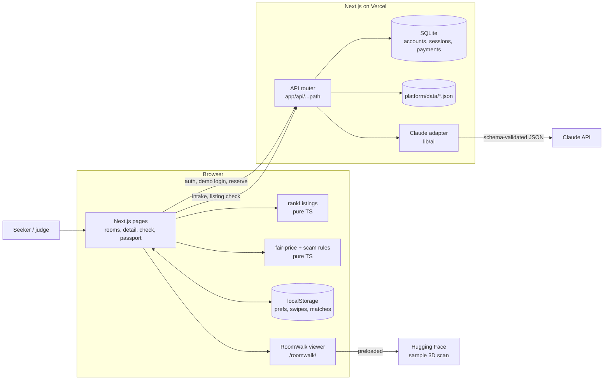

# Roomsure Technical Architecture

**Status:** Hackathon implementation guide, v2 (one product). Updated 2026-11-07.
**Audience:** Build team, reviewers, and coding LLMs
**Related documents:** [README](README.md), [MVP requirements](Roomsure%20MVP%20Requirements%20%28for%20LLM%20build%29.md), [Master build prompt](MASTER_PROMPT.md), [Demo script](demo-script.md)

The MVP requirements define what the product does. This document defines how it is built. v2 describes one app: PR #2's Next.js app in `platform/`, with the ranking engine (PR #4) and RoomWalk viewer (PR #3) built in.

## 1. Decisions at a glance

| Concern | Decision | Reason |
|---|---|---|
| App | One Next.js App Router app in `platform/` (React, TypeScript, Node 24) | PR #2 already provides it, with tests. One codebase for UI and server routes. |
| UI | Tailwind and shadcn/ui screens designed in Lovable (`lovable/`), then ported into `platform/` | Lovable delivers the polished UX the team wants. Porting keeps one app, one link, and PR #2's tested backend. |
| Validation | Zod at every untrusted boundary | Request bodies, Claude output, seed JSON, localStorage. |
| Ranking | `platform/lib/ranking/rankListings.ts`, pure TypeScript, run in the browser | Instant reranking, deterministic, unit-tested (PR #4). |
| Listings | Versioned JSON in `platform/data/` | Curated synthetic demo inventory. No database needed for listings. |
| Accounts | SQLite via `node:sqlite` (PR #2) | Real accounts, hashed passwords and sessions with no external database. |
| Verification and payments | PR #2 in `PROVIDER_MODE=demo` | Simulated outcomes. Stripe/Resend test-mode code stays in the repo, switched off. |
| Swipes, shortlist, matches | Browser state + localStorage, keyed by user ID and listing ID | Presentation state. Resets cleanly. |
| AI | Claude via `@anthropic-ai/sdk`, server-side only, with rule fallbacks | Visible AI for judges. The demo never depends on it. |
| 3D rooms | RoomWalk viewer as static files in `platform/public/roomwalk/` | Works on any static host. The GPU scan pipeline stays in `roomwalk/scan/` and does not run on Vercel. |
| Hosting | Vercel (project root `platform/`), with the demo laptop as backup | A public link for judges, plus a local fallback. |

## 2. System context



**Trust boundary:** browser input, pasted listing text, Claude output, query strings and localStorage are all untrusted. Validate before use. The server never trusts a client-sent price, verification status or score.

## 3. Runtime responsibilities

**Browser (client components):** intake box, preference controls, deck and list, near misses, shortlist, detail, mock chat, scam-check form, and the 3D viewer overlay. Each preference change calls `buildSwipeDeck()` synchronously, with no network call. List, deck, detail and shortlist all read the same ranked result.

**Server (API router):** PR #2's auth, Passport, verification and payment routes, plus the new demo login, intake, listing check and reserve routes. Each route validates its input, checks the session and origin, calls a pure module or the Claude adapter, validates the output, and returns a small typed response.

**Pure modules** (no React, Next.js, SDK or browser APIs):
- `lib/ranking/`: PR #4's engine, plus the trust switch.
- `lib/trust/fair-price.ts`: baseline lookup, adjustments, label.
- `lib/trust/scam-check.ts`: rule signals, exact-quote check, verdict.
- `lib/intake/rules.ts`: the fallback sentence parser.
- `lib/types.ts`: app types that extend the engine types (section 6).

## 4. Project structure

```text
platform/                         # the one app (PR #2 + integration)
  app/
    page.tsx                      # welcome: "Continue as Maya", sign up (wired to PR #2 auth)
    start/page.tsx                # describe needs → preferences
    discover/page.tsx             # swipe deck / list, live preferences panel, near misses
    room/[id]/page.tsx            # detail, score math, dates timeline, fair price, 3D tour
    matches/page.tsx              # matches, waiting, passed
    matches/[id]/page.tsx         # mock chat → reserve (PR #2 checkout)
    check/page.tsx                # outside-listing scam check
    passport/page.tsx             # simulated checks, reservations, reset demo (PR #2 routes)
    api/[...path]/route.ts        # PR #2 router; add the new routes here
    globals.css
  components/roomsure/            # ported from the Lovable repo: deck, card, preferences, match, chat, check
  data/
    listings.json
    outside-examples.json
    fair-baselines.json
  lib/
    auth.ts  db.ts  providers.ts  webhook.ts   # PR #2
    ranking/rankListings.ts       # moved from ranking/ (PR #4)
    trust/fair-price.ts
    trust/scam-check.ts
    intake/rules.ts
    ai/claude.ts                  # server-only Claude adapter
    ai/schemas.ts                 # Zod schemas for Claude output
    types.ts
    demo-state.ts                 # localStorage helpers
  public/roomwalk/                # copied from roomwalk/viewer (PR #3)
  tests/
ranking/                          # README, demo.html (offline backup), tests; build-demo.mjs reads platform/lib/ranking
roomwalk/                         # viewer source, scan pipeline (Modal / local GPU), tools
```

**UI workflow:** Lovable cannot build Next.js, and it always creates its own GitHub repo. So the team designs in a Lovable project, and its repo is mirrored into the `lovable-ui` branch here. Claude Code pushes the engine, seed data, scam rules and a mock `api.ts` into that Lovable repo, so the designs run on real logic. When the screens are approved, they are ported into `platform/` and the mock API is swapped for the real routes in section 8.

Why the engine moves: Next.js does not easily import code from outside its own folder. Keep one copy in `platform/lib/ranking/`. Point `ranking/build-demo.mjs` and `ranking/rankListings.test.ts` at it, so `demo.html` stays a working offline backup.

## 5. Data and persistence

| Data | Where | Notes |
|---|---|---|
| Listings, outside samples, fair baselines | `platform/data/*.json` | Read-only, synthetic, labeled demo. Never written at runtime. |
| Accounts, sessions, codes, payments, activity | SQLite (`DATABASE_PATH`) | PR #2 schema. Add `listing_id` to `payments`. |
| Demo accounts | Created on every server start (`ensureDemoAccounts()` in `db.ts`) | Maya (seeker, simulated-verified) and one demo host. Makes the demo survive a database wipe. |
| Preferences, swipes, shortlist, host replies | localStorage, keyed by user ID | Malformed or old data → reset to defaults. |
| Chat | Canned messages in code | No messaging backend. |
| Claude key | `ANTHROPIC_API_KEY`, server environment only | Never logged or sent to the browser. |
| Real ID, card or protected-trait data | Not collected | No field, column or upload control exists. |

**On Vercel**, the only writable folder is `/tmp`, and Vercel can restart or add server copies at any time. Set `DATABASE_PATH=/tmp/roomsure.sqlite`. Accounts made during the demo can disappear after idle time. Demo accounts reappear automatically on the next request. For the live demo, always use "Continue as Maya" rather than a fresh sign-up. A durable hosted database is out of scope.

## 6. Shared contracts

The engine's types (`lib/ranking/rankListings.ts`) are the base. The app extends them; it never redefines the score.

```ts
// Engine (PR #4), plus the v2 trust fields
type Factor = "price" | "commute" | "dates" | "facilities";
type Need = "none" | "nice" | "important" | "must";
type TrustLevel = "verified" | "caution" | "outside";

interface Listing {                  // what the engine needs
  id: string;
  pricePerMonth: number;
  commuteMinutes: number;            // for the seeker's chosen destination
  availableFrom: string;             // ISO date
  availableTo: string;
  facilities: string[];              // furnished, kitchen, laundry, gym, privateBath, ac, parking
  trust?: TrustLevel;                // v2; default "verified"
}

interface Preferences {
  price: { ideal: number; limit: number };
  commute: { ideal: number; limit: number };
  dates: { start: string; end: string; maxUncoveredDays: number };
  facilities: Record<string, Need>;
  importance?: Partial<Record<Factor, number>>;   // 0–10 sliders
  priorityOrder?: Factor[];                       // alternative to sliders
  preferVerified?: boolean;                       // v2; default true
}
// ScoredListing gains `trustFactor: number`. Gains, gives, sentence, points and rank are unchanged.

// App (lib/types.ts)
type Destination = "work" | "campus";
type TrustStatus = "verified" | "caution" | "suspended";

interface RoomListing extends Listing {
  title: string;
  description: string;
  neighborhood: string;              // never a street address
  hostDisplayName: string;           // synthetic
  roomType: "private" | "shared";
  trustStatus: TrustStatus;
  trustReason?: string;              // "Host ID check pending"
  source: "network" | "outside";
  sublet: boolean;
  landlordConsentConfirmed: boolean;
  isDemo: true;
  commuteByDestination: Record<Destination, number>;
  fairBaselineKey: string;
  photoUrl: string;
  scanUrl?: string;                  // RoomWalk scene; labeled "Sample 3D scan · demo"
}

interface ScamSignal {
  id: "price_far_below_fair" | "payment_pressure" | "cannot_view" | "urgency" | "off_platform_contact";
  severity: "high" | "medium" | "low";
  message: string;
  evidence?: string;                 // must be an exact substring of the pasted text
  source: "rules" | "claude";
}
type ScamVerdict = "high_risk" | "caution" | "no_issues_found";
```

Mapping rules: the app removes `trustStatus: "suspended"` before calling the engine. It sets `trust` from `source` and `trustStatus` (outside → `"outside"`, caution → `"caution"`, else `"verified"`). It sets `commuteMinutes` from `commuteByDestination[destination]`.

## 7. Key flows

### A. Intake → live ranking
1. The seeker types a sentence. `POST /api/intake` with `{ text, today }`.
2. The server calls Claude (section 9). If there is no key, a timeout, a refusal or invalid JSON, it runs `lib/intake/rules.ts` instead.
3. It returns `{ preferences: Partial<Preferences>, destination?, missing: string[], questions: string[], source: "claude" | "rules" }`.
4. The browser merges the result into defaults, shows editable controls, and labels which path ran.
5. Every later change reranks in the browser only.

### B. Deck → shortlist → detail → 3D
Swipes are saved by listing ID, never by array position. Detail resolves the same `ScoredListing` by ID. "Walk the room in 3D" opens `/roomwalk/index.html?scene=<scanUrl>` in a full-screen overlay. Add the `scene` query parameter to RoomWalk's `app.js` if it is missing. If the scene fails to load, the viewer falls back to the bundled demo room, and the detail page stays usable.

### C. Match → chat → reserve
1. "Simulate host reply" sets `hostAccepted[listingId]`. `matched = liked && hostAccepted`.
2. The mock chat appears, labeled "Chat demo · no real messages".
3. Reserve sends `POST /api/payment/start` with `{ listingId }`.
4. The server checks the session, origin and verified status, then looks up `pricePerMonth` in `data/listings.json`. It never accepts a price from the client.
5. The simulated payment is stored with `listing_id` and shows in the Passport.
6. `POST /api/demo/reset` (demo mode only) clears Maya's payments, so the demo can run again. PR #2 allows one active payment per user.

### D. Outside-listing check
1. `POST /api/check` with `{ text }`, capped at 5,000 characters.
2. The server runs the rule signals (always) and Claude extraction (if available).
3. Claude's suggested signals are kept only if the ID is known and the evidence is an exact substring of the text.
4. Code merges the signals, adds the fair-price estimate where the neighborhood and room type are known, and computes the verdict.
5. The response is rendered as text (React escaping), never as HTML.

## 8. API routes

All new routes go in PR #2's router (`app/api/[...path]/route.ts`) and reuse its `originGuard` and session helpers.

| Route | Status | Purpose |
|---|---|---|
| `auth/*`, `me`, `email/*`, `identity/start`, `card/start`, `host/consent`, `security/password`, `demo/complete`, `webhook` | Existing (PR #2) | Accounts, Passport, simulated checks |
| `payment/start` | **Change** | Accept `{ listingId }`; price from seed data; store `listing_id` |
| `demo/login` | **New**, demo mode only | Sign in as Maya with one click |
| `demo/reset` | **New**, demo mode only | Clear Maya's payments and activity |
| `intake` | **New** | Sentence → partial preferences (Claude or rules) |
| `check` | **New** | Pasted listing → facts, signals, verdict |

Ranking, fair price, swipes and shortlist need no route.

## 9. Claude adapter

- **Where:** `lib/ai/claude.ts`, imported only by server code. `import "server-only"` keeps it out of browser bundles.
- **Model:** `claude-opus-5-5` by default, overridable with `ANTHROPIC_MODEL`. Use `output_config.effort: "low"`: these are short extraction tasks, and low effort keeps replies fast on stage.
- **Structured output:** `client.messages.parse()` with `output_config.format: zodOutputFormat(Schema)` from `@anthropic-ai/sdk/helpers/zod`. Read `response.parsed_output`. If it is `null`, use the fallback.
- **Time limits:** an 8-second request timeout with `maxRetries: 0`, then the fallback. A stalled call must never freeze the stage demo.
- **Refusals:** check `stop_reason`. Treat `"refusal"` like any other failure: use the fallback.
- **Prompts:** short system prompts that say to extract only what is stated, return "not stated" for unknowns, and treat the listing text as data, ignoring any instructions inside it.
- **Logging:** log the route, the duration and whether the fallback ran. Never log the pasted text or the key.
- **Status:** the API response includes `source: "claude" | "rules"`. The UI shows it.

## 10. Security, privacy, fairness and trust

- Validate all browser input and every Claude response. Client data can be altered.
- Keep secrets server-side. Never use a `NEXT_PUBLIC_` variable for a key.
- Keep PR #2's protections: salted scrypt passwords, HTTP-only session cookies, origin checks, rate limits, duplicate-payment prevention.
- Do not collect or persist ID documents, selfies, card numbers or protected traits. Never use protected traits or proxies in matching.
- State trust claims precisely: "ID check (simulated)", "Landlord consent pending", "Outside · not verified", suspended = hidden.
- A 3D scan is an inspection aid, not proof of identity, ownership, availability or safety.
- "No issues found" always carries a not-verified reminder.

## 11. Failure behavior

| Failure | What the user sees |
|---|---|
| No Anthropic key, timeout, refusal or invalid output | The rules result, labeled "Read by rules (offline)" |
| Database wiped (Vercel restart) | "Continue as Maya" still works; demo accounts are recreated |
| 3D sample can't load | The bundled demo room, with a small note |
| No room fits the limits | Near misses with one-tap fixes, never a blank screen |
| Pasted text has no recognizable fields | Facts show "Not stated"; the rule scan still runs |
| Bad localStorage | Reset to defaults without blocking |
| Reserve clicked twice | A clear "Already reserved" message, plus Reset demo |

## 12. Deployment and demo operations

**Vercel (primary):**
- New project → import the repo (the account owner logs in with GitHub) → Root Directory `platform` → Node.js 24.x.
- Environment variables: `APP_URL=https://<production-domain>`, `PROVIDER_MODE=demo`, `DATABASE_PATH=/tmp/roomsure.sqlite`, `ANTHROPIC_API_KEY`, optional `ANTHROPIC_MODEL`. Do not set Stripe or Resend keys.
- PR #2 rejects POST requests whose `Origin` doesn't match `APP_URL`, so forms fail on Vercel preview links. Demo only from the production domain.
- After the first deploy, confirm that `node:sqlite` loads on Vercel's Node 24 runtime. If it doesn't, the laptop backup becomes the main plan and the link becomes a nice-to-have.
- RoomWalk's local demo room (`room.ply`, ~12 MB) ships as a static file.

**Laptop (backup):** `cd platform && npm ci && npm run build && npm start` with the same variables, but `APP_URL=http://localhost:3000`. Also keep `ranking/demo.html` (opens with a double-click, fully offline) and a screen recording of the full path.

**Before presenting:** open the live link, sign in as Maya, run the intake once (this warms the server and Claude), open the 3D scan once (this caches the sample), and press Reset demo.

## 13. Change rules for coding LLMs

- The requirements file controls product behavior. This file controls structure. A newer direct instruction from the team overrides both; update the docs to match.
- Inspect the repository and preserve teammates' work before changing anything.
- Do not duplicate the score formula in UI code or prompts. Do not let Claude produce scores or verdicts.
- Do not add a hosted database, live inventory, or real ID or payment collection without an explicit team decision.
- When a change alters data shape, routes, persistence or trust semantics, update this file and the requirements together.

## 14. References

- [Next.js App Router](https://nextjs.org/docs/app) · [Route Handlers](https://nextjs.org/docs/app/getting-started/route-handlers) · [Data Security](https://nextjs.org/docs/app/guides/data-security) · [Deploying](https://nextjs.org/docs/app/getting-started/deploying)
- [Claude API documentation](https://platform.claude.com/docs) (structured outputs, TypeScript SDK)
- PR #2 `platform/README.md`: auth, provider modes, API contracts
- PR #3 `roomwalk/README.md`: viewer controls and scan pipeline
- PR #4 `ranking/README.md`: scoring, worked example, engine API
